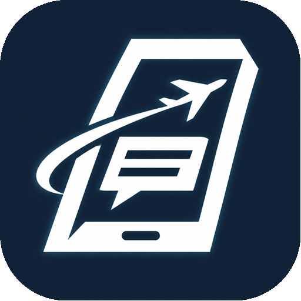
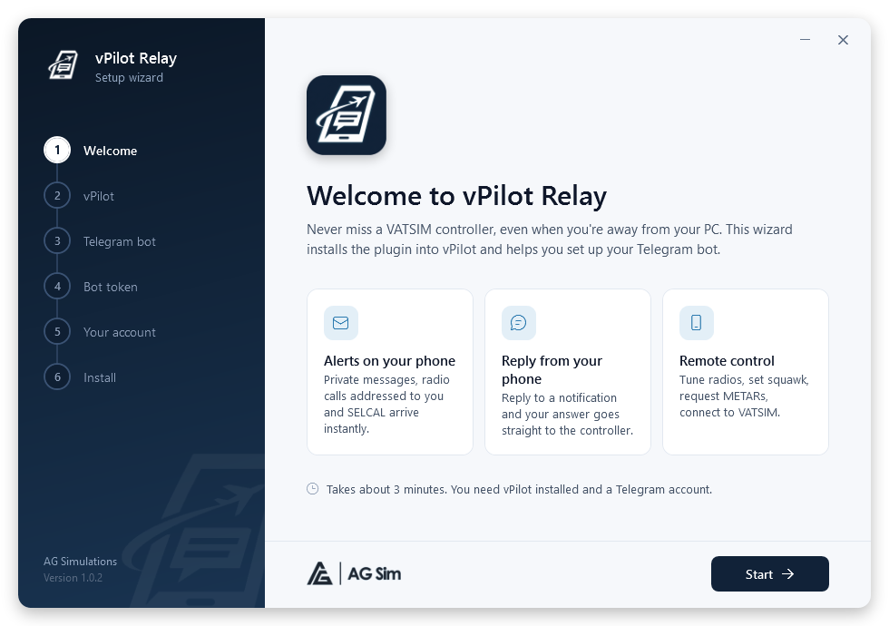

<p align="center">
  
</p>

<h1 align="center">vPilot Relay</h1>

<p align="center">
  <b>Your VATSIM radio, on your phone.</b><br>
  Get controller messages on Telegram and reply from anywhere.
</p>

<p align="center">
  <a href="../../releases/latest"></a>
  
  
  <a href="LICENSE"></a>
</p>

<p align="center">
  <a href="https://ag-simulations.com">
    <picture>
      <source media="(prefers-color-scheme: dark)" srcset="docs/images/agsim-light.png">
      
    </picture>
  </a>
</p>

---

## ✨ Features

| | |
|---|---|
| ✉️ **Private messages** | Arrive instantly — reply to the notification and it goes straight to the controller. |
| 📻 **Frequency calls** | Text messages with your callsign are flagged, and you can answer on frequency. |
| 🔔 **SELCAL & connection alerts** | Know when you're called, connected or disconnected. |
| 🎛️ **Remote control** | Tune COM1 (UNICOM + nearby ATC), set squawk, ident, request METAR/ATIS, see online ATC. |
| 🟢 **Connect from your phone** | One tap with a recent callsign, or enter callsign, aircraft type and SELCAL. |
| 🔕 **Silent mode** | Quiet notifications — private messages and SELCAL still ring. |

Everything is behind one command: **`/menu`**.

<p align="center">
  
</p>

## 🚀 Install in 3 minutes

The setup wizard does everything for you — **no files to copy, no settings to edit.**

1. **Close vPilot** and download **`vPilotRelay-Setup-x.y.z.exe`** from the **[latest release](../../releases/latest)**.
2. **Run it and follow the wizard.** It finds vPilot, walks you through creating your Telegram bot, checks your token and recognises your account automatically.
3. **Start vPilot.** When *"✈️ vPilot Relay is running."* arrives on Telegram, you're ready.

> **Windows protected your PC?** The installer isn't code-signed yet — click **More info → Run anyway**.

**Requirements:** Windows · [vPilot](https://vpilot.rosscarlson.dev/) 3.x · a Telegram account · MSFS 2020/2024 for radio and squawk features.

**Updating** is just as easy: run the new installer and choose **Keep settings, update**.

<details>
<summary><b>Manual install</b></summary>

1. Create a bot with **@BotFather** in Telegram (`/newbot`) and copy its token.
2. Close vPilot. From the release `.zip`, copy `vPilotRelay.dll` and `vPilotRelay.ini` to `%LOCALAPPDATA%\vPilot\Plugins`, then right-click the DLL → **Properties** → **Unblock**.
3. Put the token on the `BotToken=` line of `vPilotRelay.ini`.
4. Start vPilot and send your bot any message — it replies with your Chat ID. Close vPilot, put it on the `ChatId=` line, start vPilot again.

</details>

## 💬 Usage

Swipe a notification (or long-press → **Reply**) to answer. Or send **`/menu`** for buttons.

<details>
<summary><b>All commands</b></summary>

| Command | What it does |
|---|---|
| `/menu` | Main menu with buttons |
| `/connect BAW123 B738 AB-CD` | Connect to VATSIM (SELCAL optional) |
| `/pm EGLL_TWR message` | Private message |
| `/radio message` | Send on the active TX frequency |
| `/freq 118.100` · `121.800 s` · `124.350 2` | COM1 active · COM1 standby · COM2 active |
| `/atc` | Online ATC nearby |
| `/metar EGLL` · `/atis EGLL_ATIS` | METAR · ATIS / controller info |
| `/squawk 1234` · `/ident` | Transponder code · ident |
| `/status` | Aircraft and connection status |
| `/mute` | Toggle notification sound |

**Radio alerts:** *mentions only* (default) relays frequency messages containing your callsign; *all* relays every text message on your frequencies. Voice is never relayed.

</details>

<details>
<summary><b>Settings (<code>vPilotRelay.ini</code>)</b></summary>

```ini
[Telegram]
BotToken=          ; token from @BotFather
ChatId=            ; your Telegram chat

[Relay]
Private=true       ; private messages
Radio=true         ; frequency text messages
RadioMode=mentions ; mentions | all
Selcal=true
Broadcast=true     ; supervisor / server broadcasts
Connection=true    ; connected / disconnected
```

Changes apply after restarting vPilot. The bot only obeys the chat in `ChatId`.

</details>

<details>
<summary><b>Troubleshooting</b></summary>

| Problem | Fix |
|---|---|
| The bot doesn't answer | It only works while vPilot is running. |
| No "is running" message | Run the setup wizard again. |
| The plugin doesn't load | Delete `RossCarlson.Vatsim.Vpilot.Plugins.dll`/`.xml` from the `Plugins` folder if present. |
| Frequency or squawk didn't change | Some add-on aircraft ignore external radio commands — set it in the cockpit. |
| "Could not connect to the simulator" | Start the simulator and load a flight. |

Details are logged in vPilot's debug window, prefixed with `[vPilot Relay]`.

</details>

## 📄 License

Free and open source under the [GNU GPL v3.0](LICENSE) — © 2026 [AG Simulations](https://ag-simulations.com).

<details>
<summary>Additional permission, trademarks and disclaimer</summary>

**Additional permission under GNU GPL version 3 section 7:** if you modify this program, or any
covered work, by linking or combining it with the vPilot plugin API (`RossCarlson.Vatsim.Vpilot.Plugins`),
Microsoft Flight Simulator SimConnect (`Microsoft.FlightSimulator.SimConnect`), or a modified version
of those libraries, containing parts covered by the terms of their respective licenses, AG Simulations
grants you additional permission to convey the resulting work.

**Trademarks:** the vPilot Relay logo and the AG Simulations / AG Sim logo are trademarks of
AG Simulations and are **not** covered by the GPL. If you distribute a modified version, please use
your own name and artwork.

This program is distributed in the hope that it will be useful, but **without any warranty**.
vPilot is developed by Ross Carlson; this project is not affiliated with vPilot, VATSIM or Telegram.
Inspired by [blt950/vPilot-Pushover](https://github.com/blt950/vPilot-Pushover).

</details>
